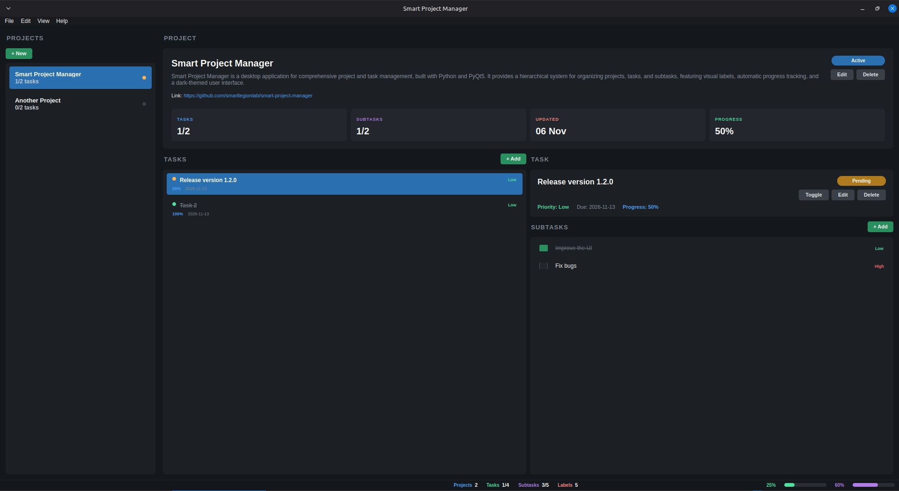

# Smart Project Manager

---

## Overview

**Smart Project Manager** is a desktop application for comprehensive project and task management, built with Python and PyQt5. It provides a hierarchical system for organizing projects, tasks, and subtasks, featuring visual labels, automatic progress tracking, and a dark-themed user interface.

*   **Author:** Alexander Suvorov
*   **GitHub:** [smartlegionlab](https://github.com/smartlegionlab)

---

[](https://github.com/smartlegionlab/smart-project-manager/)

[](https://github.com/smartlegionlab/smart-project-manager/blob/master/LICENSE)
[](https://github.com/smartlegionlab/smart-project-manager/stargazers)
[](https://github.com/smartlegionlab/smart-project-manager/network/members)

---

## Screenshot



---

## Features

### Three-Pane Splitter Workspace
*   Left pane: project list
*   Top-right: project card with status, counters and overall progress
*   Bottom-right, two panes side by side: task list and the selected task with its subtasks
*   Splitter handles are resizable; panes never collapse completely
*   Each pane has a strict uppercase label (`PROJECTS`, `PROJECT`, `TASKS`, `TASK`, `SUBTASKS`)

### Project Management
*   Create, edit and delete projects with name, optional description, and optional link
*   The link field is available only when editing an existing project, so project creation stays minimal
*   Link input is validated: a scheme (for example `https://`) is required
*   Project name is limited to 100 characters and description to 2000 characters, with live counters
*   Full CRUD for projects via context menu, Edit menu, and the project card buttons

### Task Management
*   Task list with inline visual state (status dot, title, priority, progress, due date, labels)
*   Create, edit and delete tasks
*   Task title limited to 100 characters and description to 2000 characters, with live counters
*   Toggle completion, edit and delete directly from the task list context menu or the task header
*   Automatic task completion when all subtasks are completed

### Subtasks
*   Simplified subtasks: title and priority only
*   Subtask title limited to 100 characters, with a live counter
*   Mark as completed with a checkbox on the row, or via context menu
*   Create, edit and delete subtasks

### Labels
*   Custom labels with name, color, text color and description
*   Assign labels to tasks for categorization
*   Dedicated Label Manager dialog for creating, editing and deleting labels

### Progress Tracking & Statistics
*   Per-project progress bar in the project card
*   Per-task progress based on subtasks
*   Compact global statistics panel in the status bar (always visible): projects, tasks, subtasks, labels, and completion rates

### User Interface
*   Dark theme optimized for extended use
*   No decorative borders, only subtle background separation between panes
*   Flat buttons, uppercase panel headers
*   Context menus everywhere for CRUD actions
*   Built-in Help, About and Keyboard Shortcuts dialogs accessible from the Help menu

### Data Persistence
*   Automatic saving to `~/.smart_project_manager/projects.json`
*   JSON-based storage for projects, tasks, subtasks and labels
*   Data loaded automatically on application startup
*   Manual backups and automatic cleanup of backups older than 30 days

### Stable Selection
*   Selection in all three lists is preserved across any CRUD operation
*   Programmatic selection updates do not emit change signals
*   A single reload path restores project, task and subtask selection consistently

---

## Requirements

*   Python 3.7 or higher
*   Git (only for the installer)
*   curl (only for the installer)
*   PyQt5

---

## Installation

There are **two independent ways** to use this application:

*   **Run from source** - clone the repo, create a virtual environment, launch manually. Nothing is installed system-wide.
*   **Install system-wide** - one command creates a menu entry. Desktop shortcut is opt-in.

Choose one. They are not meant to be combined.

### Option 1 - Run from Source (no system install)

Use this if you just want to try the app or run it manually from a folder.

```bash
# 1. Clone the repository
git clone https://github.com/smartlegionlab/smart-project-manager.git
cd smart-project-manager

# 2. Create a virtual environment
python3 -m venv venv

# 3. Activate it
source venv/bin/activate

# 4. Install dependencies
pip install -r requirements.txt

# 5. Launch the app
python app.py
```

To run it again later:

```bash
cd smart-project-manager
source venv/bin/activate
python app.py
```

Nothing is installed system-wide. The app runs from this folder.

### Option 2 - Install System-Wide (recommended)

Use this if you want the app in your application menu.

#### One-command install

```bash
curl -fsSL https://raw.githubusercontent.com/smartlegionlab/smart-project-manager/master/install.sh | bash
```

**What the installer does:**

1. Downloads the source code from GitHub.
2. Installs the application to `~/.local/share/smart-project-manager/`.
   No root, no sudo - everything lives inside your home directory.
3. Creates a dedicated Python virtual environment at `~/.local/share/smart-project-manager/venv/` and installs dependencies into it.
4. Registers the app in your desktop environment by creating `~/.local/share/applications/smart-project-manager.desktop`.
5. Refreshes the desktop database so the menu entry appears without a full re-login on most systems.

**Launch after install:**
*   Application menu -> **Smart Project Manager**

**Desktop shortcut (opt-in):**

By default, no Desktop shortcut is created. This is intentional - on GNOME (default on Ubuntu), desktop icons are hidden by default, which would make a shortcut invisible and confusing.

To also create a Desktop shortcut during install, pass the `SPM_CREATE_DESKTOP_SHORTCUT=1` environment variable to **bash** - the second command in the pipeline:

```bash
curl -fsSL https://raw.githubusercontent.com/smartlegionlab/smart-project-manager/master/install.sh | SPM_CREATE_DESKTOP_SHORTCUT=1 bash
```

Or export it first, then run the normal installer:

```bash
export SPM_CREATE_DESKTOP_SHORTCUT=1
curl -fsSL https://raw.githubusercontent.com/smartlegionlab/smart-project-manager/master/install.sh | bash
```

> **Note:** Writing `SPM_CREATE_DESKTOP_SHORTCUT=1 curl ... | bash` does **not** work - in a shell pipeline, an environment variable prefix applies only to the command on the **left** side of the `|`. The variable never reaches `bash`, which is on the right side. Pass it to `bash` directly, or `export` it beforehand.

**Notes:**
*   On GNOME (default on Ubuntu), desktop icons may be hidden by default. Enable Desktop Icons in GNOME Tweaks to see the shortcut.
*   The Desktop shortcut may show an **"Unsecured Application Launcher"** warning. Right-click -> **Allow Launching** (one-time action).
*   If the menu entry does not appear immediately, log out and back in.

#### Alternative - install from a cloned repo

If you already cloned the repository, you can run the installer locally:

```bash
cd smart-project-manager
./install.sh
```

It works the same way. It ignores any local `venv/` and creates its own under `~/.local/share/smart-project-manager/venv/`.

### Uninstall

```bash
curl -fsSL https://raw.githubusercontent.com/smartlegionlab/smart-project-manager/master/uninstall.sh | bash
```

**What the uninstaller removes:**
*   `~/.local/share/smart-project-manager/` - the application and its venv
*   `~/.local/share/applications/smart-project-manager.desktop` - the menu entry
*   `~/Desktop/smart-project-manager.desktop` - the Desktop shortcut (if present)

**What the uninstaller never touches:**
*   `~/.smart_project_manager/projects.json` - your projects, tasks, subtasks and labels. It is your data. Only you decide what to do with it.

If you want to remove your data as well, run after uninstall:

```bash
rm -rf ~/.smart_project_manager
```

### Installation Paths

| Item                       | Path                                                              |
|----------------------------|-------------------------------------------------------------------|
| Application files          | `~/.local/share/smart-project-manager/`                           |
| Virtual environment        | `~/.local/share/smart-project-manager/venv/`                      |
| Application menu entry     | `~/.local/share/applications/smart-project-manager.desktop`       |
| Desktop shortcut (opt-in)  | `~/Desktop/smart-project-manager.desktop`                         |
| User data (projects)       | `~/.smart_project_manager/projects.json`                          |

---

## How to Use

### Getting Started
1.  **Create a project:** `File -> New Project` (`Ctrl+N`) or the **+ New** button in the `PROJECTS` pane. Enter a name and, optionally, a description. The link field becomes available later, when you edit the project.
2.  **Select a project:** click it in the `PROJECTS` list on the left. The project card in the top-right and the task list in the bottom-left update automatically.
3.  **Create a task:** with a project selected, use `File -> New Task` (`Ctrl+T`) or the **+ Add** button in the `TASKS` pane.
4.  **Select a task:** click it in the `TASKS` list. The `TASK` header and the `SUBTASKS` list update automatically.
5.  **Create a subtask:** with a task selected, use `File -> New Subtask` (`Ctrl+Shift+T`) or the **+ Add** button in the `SUBTASKS` pane. Fill in title and priority.
6.  **Manage labels:** `Edit -> Manage Labels` (`Ctrl+L`) to create, edit and delete labels.

### Workspace Layout

*   The window is split into three logical areas, each with its own header.
*   The vertical splitter on the left separates the project list from the workspace.
*   The workspace is split vertically into the project card (top) and the task/subtask area (bottom).
*   The task/subtask area is split horizontally into the task list (left) and the selected task with its subtasks (right).
*   All splitter handles are draggable. Panes never collapse completely, so you cannot accidentally hide the project list or the task list.

### Projects

*   Name is limited to 100 characters and description to 2000 characters. Both have live counters in the dialog.
*   The optional link is only shown in edit mode. It is validated: a scheme such as `https://` is required.
*   The project card shows the name, description, optional link, status badge, and four tiles: `TASKS`, `SUBTASKS`, `UPDATED`, `PROGRESS`.
*   Full CRUD: context menu in the project list, `Edit -> Edit Project` (`Ctrl+E`), `Edit -> Delete Project` (`Ctrl+D`), and the `Edit` / `Delete` buttons on the project card.

### Tasks

*   Title is limited to 100 characters and description to 2000 characters. Both have live counters in the dialog.
*   The task list shows a status dot, the title, the priority, the progress, the due date and up to two labels.
*   Double-clicking a task is not required - selection is instant. The `TASK` header shows the title, description, priority, due date, progress, and the toggle / edit / delete buttons.
*   Full CRUD: context menu in the task list, `Edit -> Edit Task` (`Ctrl+Shift+E`), `Edit -> Delete Task` (`Ctrl+Shift+D`), and the buttons in the `TASK` header.

### Subtasks

*   Subtasks are simplified: title and priority only.
*   Title is limited to 100 characters, with a live counter in the dialog.
*   Mark a subtask complete with the checkbox on the row, or via the context menu.
*   Full CRUD: context menu in the `SUBTASKS` list, or **+ Add** in the `SUBTASKS` pane header.
*   When all subtasks of a task are completed, the parent task is marked completed automatically.

### Stable Selection

Selection in the three lists is preserved across every CRUD operation. For example:

*   Select a project, select a task, then create a new subtask. The task and project selections stay in place.
*   Select a project, select a task, switch to another project, then come back. The previously selected task is restored.
*   Toggle a task or subtask. The corresponding row remains selected.

This works because:

*   Programmatic selection updates do not emit change signals.
*   A single reload path restores project, task, and subtask selection consistently.

---

### Desktop Integration (Linux)

> **Note:** If you installed the app via `install.sh`, the application menu entry is already created automatically. The in-app option described below is useful when you run the app manually from a custom location, or when you want to add a Desktop shortcut on demand. It is also the recommended way for development: it creates a shortcut pointing to the **currently running instance** (your working copy), not to a copy under `~/.local/share/`.

**Creating Application Shortcuts:**

The application allows you to create desktop entries directly from the menu:

1. **Go to File -> Create Desktop Entry**
2. **Choose locations:**
   *   Application Menu (`~/.local/share/applications/`) - adds to system app menu
   *   Desktop (`~/Desktop/`) - creates shortcut on desktop
3. **Click "Create Entry"**

**What happens:**
*   Creates `.desktop` file(s) with proper configuration
*   Sets executable permissions automatically
*   Uses application icon if available

**After creation:**
*   **Application Menu**: log out and back in (or restart desktop) for the entry to appear
*   **Desktop shortcut**: may show "Unsecured Application Launcher" warning
    *   Right-click on shortcut -> "Allow Launching" or "Trust"
    *   This is a one-time security confirmation

**Note:** this feature is only available on Linux systems with desktop environments that support `.desktop` files (GNOME, KDE, XFCE, etc.).

---

### Keyboard Shortcuts

| Shortcut         | Action                                |
|------------------|---------------------------------------|
| `Ctrl+N`         | New project                           |
| `Ctrl+T`         | New task in the current project       |
| `Ctrl+Shift+T`   | New subtask in the current task       |
| `Ctrl+E`         | Edit current project                  |
| `Ctrl+D`         | Delete current project                |
| `Ctrl+Shift+E`   | Edit current task                     |
| `Ctrl+Shift+D`   | Delete current task                   |
| `Ctrl+B`         | Create backup                         |
| `Ctrl+I`         | Import                                |
| `Ctrl+Shift+S`   | Export                                |
| `Ctrl+L`         | Manage labels                         |
| `F5`             | Refresh view                          |
| `F1`             | Open help                             |
| `Ctrl+/`         | Show keyboard shortcuts dialog        |
| `Ctrl+A`         | Open about                            |
| `Ctrl+Q`         | Exit application                      |

---

## Data Storage

| Item           | Path                                                       |
|----------------|------------------------------------------------------------|
| Projects       | `~/.smart_project_manager/projects.json`                   |
| Backups        | `~/.smart_project_manager/backups/`                        |

Backups older than 30 days are cleaned up automatically on application startup. Manual cleanup is also available from `File -> Show Backups`.

### Data Format Notes

*   `projects` entries may contain `link` (optional string, added in this release).
*   `subtasks` entries contain only `id`, `title`, `priority`, `completed`, `task_id`, `project_id`, and timestamps.
*   Older data files with `description`, `due_date`, or `labels` on subtasks still load correctly; those fields are ignored on import.
*   Exports from this version no longer include those unused subtask fields.

---

## License

This project is licensed under the **BSD 3-Clause License**. See the [`LICENSE`](LICENSE) file in the project repository for full details.

---

**Copyright (c) 2026, Alexander Suvorov. All rights reserved.**


---

## Disclaimer

**By using this software, you agree to the full disclaimer terms.**

**Summary:** Software provided "AS IS" without warranty. You assume all risks.

**Full legal disclaimer:** See [DISCLAIMER.md](https://github.com/smartlegionlab/smart-project-manager/blob/master/DISCLAIMER.md)

